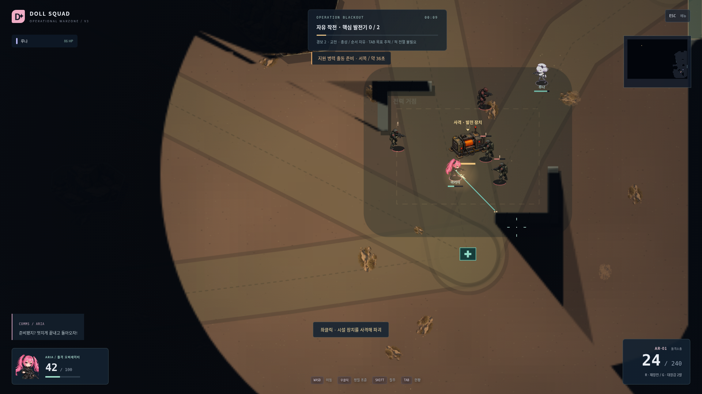

# PROJECT DOLL SQUAD · V4 TOTAL WARFARE

귀여운 PNG 오퍼레이터가 싸우는 **1–4인 서버 권한형 협동 탑다운 슈터**. V3를 보존하면서 황무지 지형, 방향 장갑, 정찰 드론·진압병·보행병기·공성 병기, 실제 경로로 접근하는 대응 전력을 구현했습니다. 적 전멸 없이 발전기 두 기를 파괴하고 수송기로 탈출합니다.



## 실행

Node.js22 이상, 최신 데스크톱 Chrome/Edge 권장. Windows PowerShell/cmd에서도 기본 명령은 같습니다.

```sh
npm install
npm run dev
```

[http://localhost:3000](http://localhost:3000)에 접속합니다. 한 명이 분대를 생성하고 친구가 같은 서버의5자리 방 코드로 참여합니다. 분대장이 Seed·난이도1–10·계약을 선택하고 전원이 준비하면 출격합니다. 서버 코드 변경 후 개발 명령을 다시 실행하세요.

```sh
npm run build
npm start
npm test
```

빌드는 TypeScript 검사, Vite 클라이언트, Node 서버를 생성합니다. HTTP/WebSocket은 단일 포트입니다. 이미지·소리는 프로젝트에 포함되며 실행 시 이미지 생성 API나 외부 오디오 서비스가 필요하지 않습니다. 환경변수 `PORT` 기본3000, `DATA_DIR` 기본`data`, `ROOM_GRACE_MS` 기본60000. PowerShell 포트 변경: `$env:PORT=3002; npm run dev`.

## BLACKOUT

- 공유 Fog로 정찰하고 자유로운 방향·순서로 **발전기 A/B를 사격해 파괴**하세요. 경비 전멸은 필요하지 않습니다.
- 통신탑은 외부 대응을 지연하고 대기 요청을 취소합니다. 전초기지·정비 병영 파괴는 실제 출동 능력을 줄입니다. 출입구에서 E를3초 유지하면 봉쇄합니다. 이미 행군 중인 적이 사라지지는 않습니다.
- 기밀과 선택 목표는 추가 보상을 줍니다. 모두 수행할 의무는 없습니다.
- 두 발전기 파괴 후 후보 탈출 원에서 E로 수송기를 호출합니다.24초 후 착륙하며, **연결된 전원**이 반경140 안에서3초 집결하면 귀환합니다. 쓰러진 대원은 구조해야 하며 착륙65초 후 수송기가 철수합니다.
- 작전 제한은 화면에 표시되는30분입니다. 결과에서 보상을 받고 재출격합니다. 목표 완료 후에도 적의 수색·증원은 계속됩니다.

## 장갑 대응과 난이도

진압병은 준비 동작 뒤 지속 사격하고 과열합니다. 보행병기는 기관포탄을 연사하며 후방의 주황색 약점이 취약합니다. 정찰 드론은 실제 시야로 발견한 위치를 전달합니다. 공성 병기는 관측했던 고정 좌표에 포격하며 착탄 전에 원형 경고가 나타납니다. 암석·벽으로 시야와 폭발을 차단하거나 강적을 우회할 수 있습니다.

로비 전술 장비: **발사기2발 / 이동 −4%**, 또는 **예비 탄약 +60**. G로 발사하며 일반 보급품에서도 제한적으로 대장갑1발을 얻습니다. 기본 총기의 중장비 정면 공격은 비효율적입니다. 도탄 표시가 보이면 측후면·로켓·우회를 선택하세요.

1–4는 보병 중심,5–6은 진압병,7은 정찰 드론,8은 보행병기,9–10은 공성 지원이 추가됩니다. 일반 보병 HP는 인원·난이도로 증가하지 않습니다. 최고 경보에서는 별도 출동 슬롯의 장갑 전력과 정예 분대가 실제 출입구·외곽 도로로 접근합니다. 총성 하나로 최고 경보가 되지는 않습니다.

## 조작

| 입력 | 동작 |
|---|---|
| WASD / 마우스 | 이동 / 독립 조준 |
| 좌클릭 / 우클릭 | 사격 / 정밀 조준 |
| Shift | 질주, 사격 불가 |
| R / G | 재장전 / 대장갑 발사 |
| E | 보급·기밀·출입구 봉쇄·탈출 요청 |
| F 유지 | 동료 소생 |
| Tab 유지 | 분대·목표 현황, 목표 추적 |
| Esc | 메뉴, 협동 전장은 계속 진행 |

오사는 없습니다. 피격이 끊기면45 HP까지만 회복합니다. 보급은 주변 분대도 회복합니다. AR/SMG 기본 제공, SG220 CR 해금, 개조140 CR. 초기300 CR이며 성장 데이터 형식은 V3와 호환됩니다.

## 로컬·LAN·인터넷

같은 PC에서는 서로 다른 브라우저 프로필/격리 시크릿 컨텍스트를 사용하세요. 같은 프로필의 탭은 동일 익명 오퍼레이터여서 새 접속이 이전 접속을 대체합니다.

LAN 친구는 서버 PC의 `http://LAN-IP:3000`으로 접속합니다. TCP 방화벽 허용이 필요하며 방 코드는 같은 서버 안에서만 유효합니다. 작전 도중 신규 참가는 제한하며 기존 대원은 같은 토큰으로60초 안에 재접속할 수 있습니다. 분대장 권한 이전·빈 방 정리를 유지합니다.

인터넷은 공용 Node 호스트/포트 전달과 HTTPS/WSS 프록시의 WebSocket Upgrade 설정이 필요합니다. 정적 호스팅만으로 동작하지 않습니다. 공개 서버 배포, 서로 다른 실제 인터넷 회선, Windows 실기 검증은 수행하지 않았습니다. `/health`를 제공합니다.

`data/profiles.json`의 원자적 저장·백업을 유지합니다. localStorage의 `doll-token`이 익명 진행도를 복원합니다. 서버 재시작 후 진행도는 유지하지만 진행 중 작전은 복원하지 않습니다. 토큰은 공개 분대 스냅샷에 포함되지 않습니다.

## QA와 자료

[실제 규칙](GAME_DESIGN.md), [검증·성능·한계](QA.md), [구현 기록](docs/v4/IMPLEMENTATION.md), [밸런스](docs/v4/BALANCE.md), [시험 결과](docs/v4/TEST_RESULTS.md), [PNG 출처](assets/README.md).

```sh
npm run build
npm test
npm run qa:session
npm run qa:v4
npm run qa:stability
```

브라우저 QA는 Playwright와 Chromium이 필요합니다. Linux 기본 `/usr/bin/chromium`, 다른 경로는 `CHROMIUM_PATH`를 지정하세요. `qa:session`은 빌드 서버와 실제 DOM 브라우저 시험을 같이 실행·정리합니다. `QA_PLAYERS=1|2|4`, `QA_DIFFICULTY`, `QA_SEED`, `QA_PREPARED=1`, `QA_STRATEGY=all`, `QA_ALLOW_FAILURE=1`, `QA_VIDEO=1`, `QA_OUTPUT`으로 시나리오를 선택합니다. 환경변수 설정 문법은 쉘에 따라 다릅니다.

`qa:v4`는 필터된 공개 정보로 일반 입력만 보내는 난이도/인원/Seed 행렬입니다. `QA_LEVELS`, `QA_COUNTS`, `QA_SEEDS`, `QA_MODE`, `QA_EXTRA=0`, `QA_MAX_SECONDS`, `QA_REPORT_DIR`로 줄여 재현할 수 있습니다. 이는 사람 플레이 평가가 아닙니다. `QA_SCRIPTS=scripts/render-qa.ts,scripts/audio-qa.ts npm run qa:dev`는 개발 서버의 별도 렌더/음향 검사입니다.

V2/V3 소스 이력과 원본 증거는 Git 및 `docs/v2/`, `docs/v3/`에 보존했습니다. V4의 최종 검증 범위와 미완료 사항은 QA 문서를 기준으로 확인하세요.
