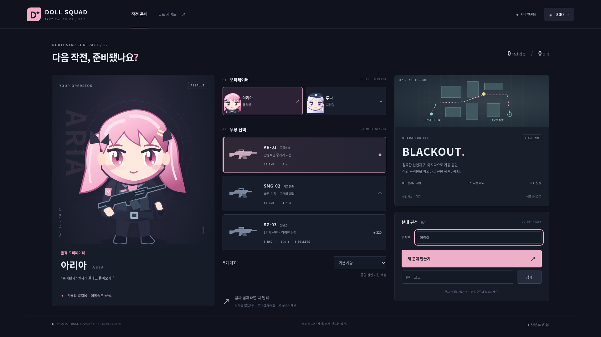
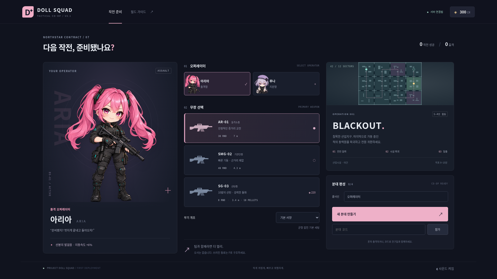
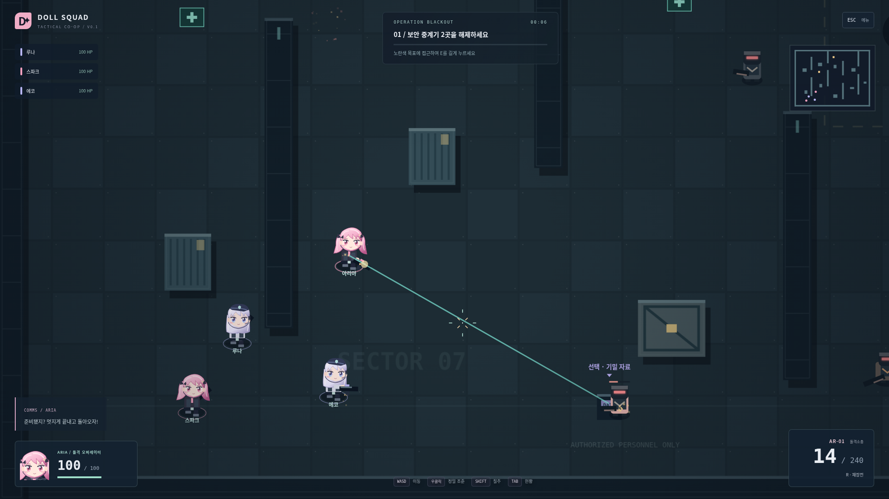
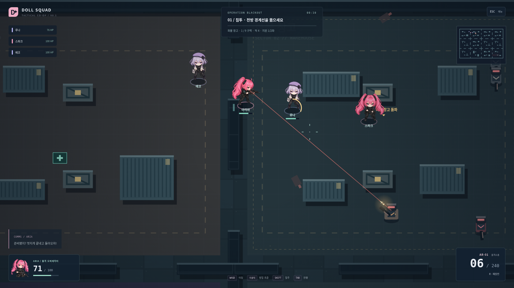
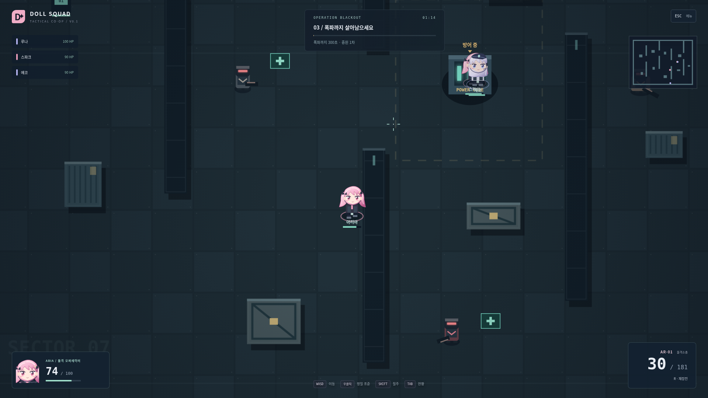
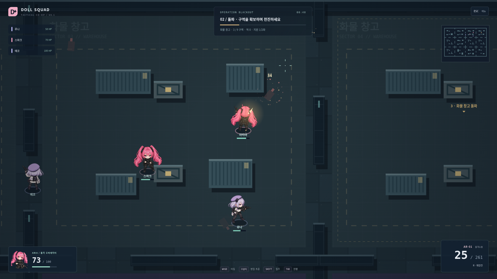
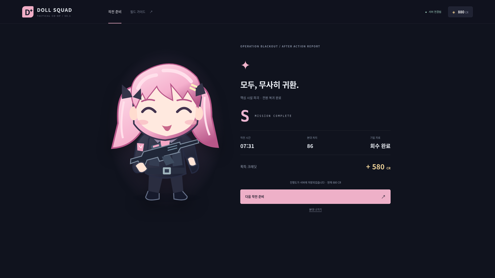
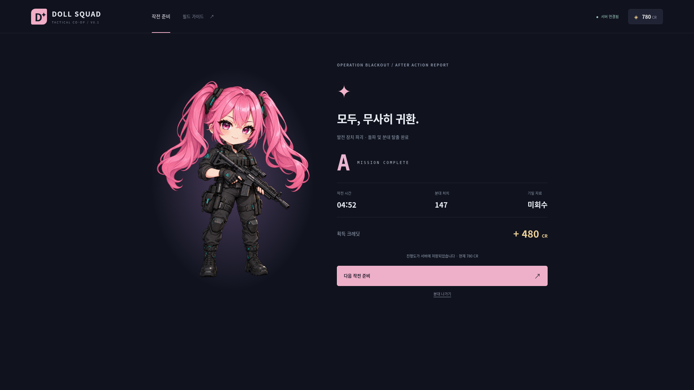

# 실제 실행 화면 전/후 비교

전: 구조조정 시작 전에 보존한 기존 실행 캡처. 후: 수정된 클라이언트를 실제 Chromium으로 실행해 캡처했습니다. 생성 컨셉 이미지나 가상 UI 화면이 아닙니다.

## 로비

| 이전 SVG 캐릭터                | 공식 PNG 기반 초상화               |
| ------------------------------ | ---------------------------------- |
|  |  |

## 월드 사격

| 이전 월드 표현                  | 방향별 래스터 캐릭터와 개편된 교전 |
| ------------------------------- | ---------------------------------- |
|  |      |

## 임무

| 이전 고정 방어                    | 계속 전진하는 구역 돌파              |
| --------------------------------- | ------------------------------------ |
|  |  |

## 결과

| 이전 결과                       | 개편 작전의 실제 결과               |
| ------------------------------- | ----------------------------------- |
|  |  |

소요 시간·성공 여부·무장·검증 수준은 루트 `QA.md`와 측정 JSON에서 확인하세요. `after/render-benchmark.png`는 별도의 합성 부하 화면이며 작전 성공/재미의 증거로 사용하지 않습니다. `docs/screenshots/`는 이전 및 전환 중 실행의 역사적 캡처를 포함합니다. 최종 화면은 `docs/after/`입니다.
