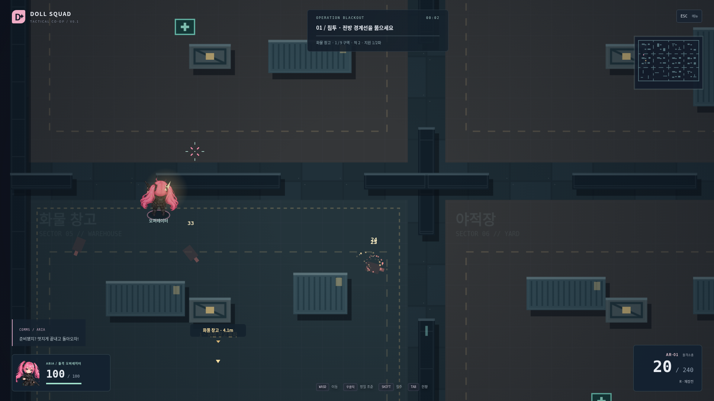
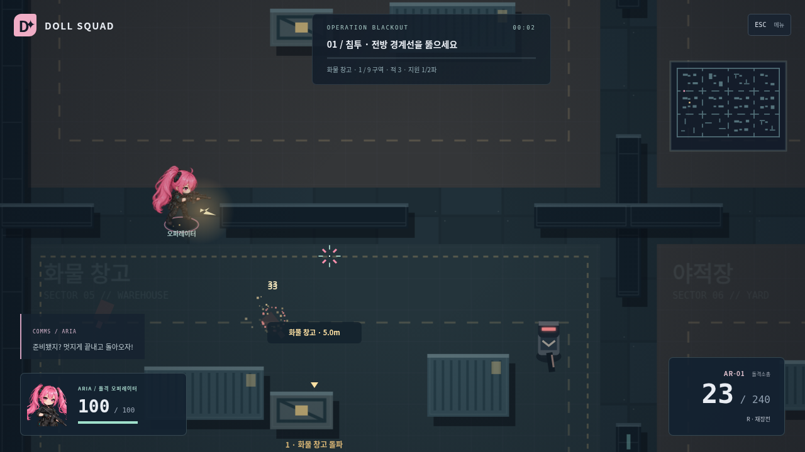
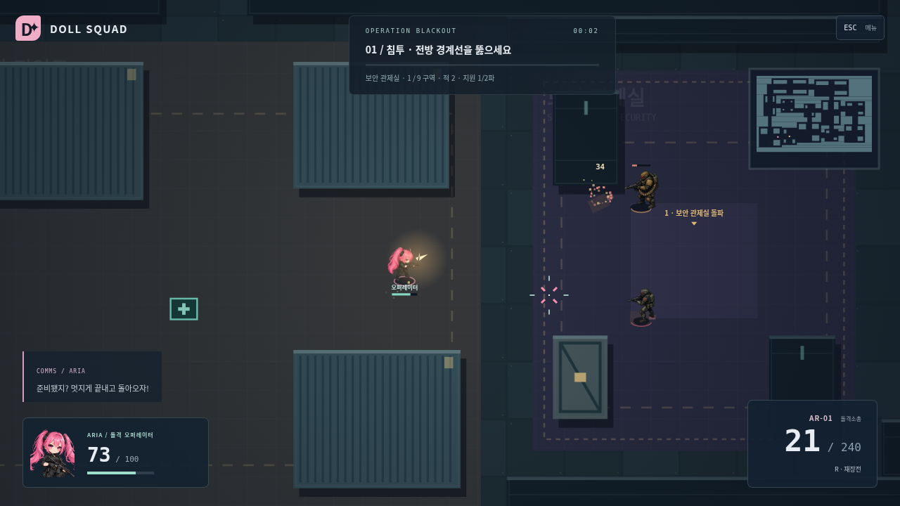
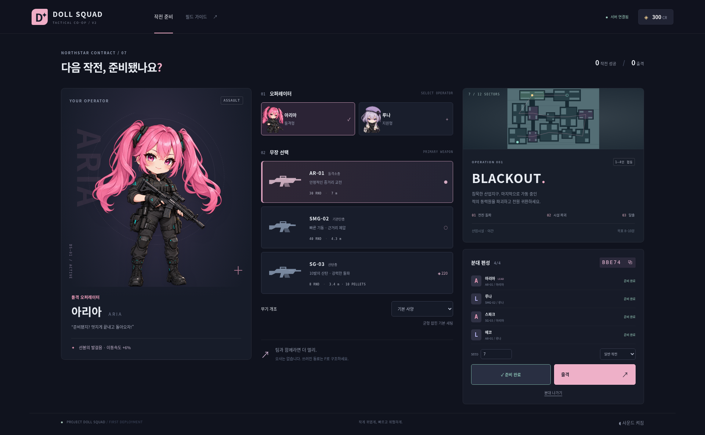
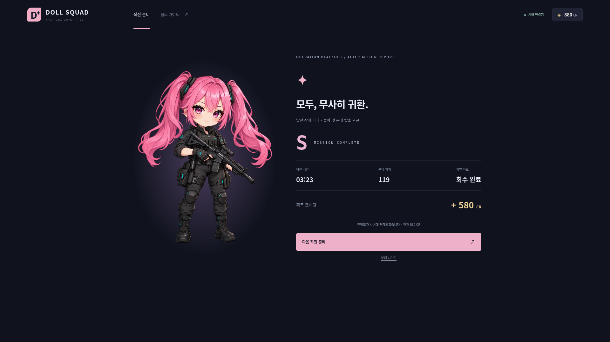

# DOLL SQUAD V2 — 변경과 실제 전후 화면

V1 소스 커밋 `1cbecf0`의 실제 캡처를 before에 보존했습니다. after는 V2를 실행한 Chromium 화면입니다. 서로 다른 순간의 교전 캡처이며 동일 프레임의 합성 비교가 아닙니다. 이미지 생성으로 전투 화면을 흉내내지 않았습니다.

| 항목                  | 변경 전                                | V2                                                            |
| --------------------- | -------------------------------------- | ------------------------------------------------------------- |
| 아군/전술 시야        | 시트104, 1080p 줌1.12                  | 시트64, 줌.95; 720p .82                                       |
| 적 표현               | Canvas 로봇 도형                       | 실제 PNG, 3종×4방향 장갑병; 60/66 높이                        |
| 카메라                | 마우스 거리×.13                        | 정밀 조준 선행, 이동 선행48, 합산195 제한, 지수 보간          |
| 사격 흔들림 AR/SMG/SG | 2/.85/5.5                              | 4/1.7/9 + 방향 반동5/2.3/12                                   |
| 총성                  | 삼각/사각 파형과 노이즈, 음악적 타격음 | 필터 노이즈 충격, 저음, 짧은 스테레오 잔향, 금속성 장전·탄착  |
| 첫 사격               | 최초1~2초 대기 뒤 .42/.3/.85 준비      | 최초 대기 없음, .2/.16/.55 준비                               |
| 적 행동               | 개별 추적·횡이동·제한된 엄폐           | 무전 연쇄 호출, 8초 좌표 기억, 엄폐 모서리, flank/anchor 역할 |
| 구조                  | 4×3 같은 크기의 방, 4가지 순회         | 5000×3300, 크기가 다른12시설 날개, 꺾인 복도·순환 보조 통로   |
| 시야                  | 벽 너머 적도 화면에 표시               | 분대 시야·벽 검사로 적/공격예고 표시 제한                     |

## 유지한 것과 교체한 것

서버 권한형 WebSocket, 입력·판정, 1~4인 방 코드와 로비·준비, 진행도와 보상, 재접속과 방 정리, 세 무기/두 아군/세 적, 전진하는 BLACKOUT 단계와 60초 탈출, 자동·브라우저 QA를 재사용했습니다. SVG 아군을 다시 넣지 않았습니다. 공식 아리아 원본은 그대로입니다.

균일 맵 생성 전체, 적 기본 몸체 렌더러, 단독 추적 중심 AI, 카메라 선행과 무기음 레이어를 교체했습니다. 성장·캐릭터·총기 종류는 늘리지 않았습니다.

## 1920×1080 실제 교전

변경 전 — V1, 큰 캐릭터/같은 크기 모듈:

변경 후 — V2, 축소된 캐릭터/대형 구조물/생성 적:

## 1280×720 실제 교전

## 네 명 분대와 결과

## 검증 해석

순간 피격 밝기·붉은 피격 테두리·섬광·탄도·숫자·처치 마커, 두 화면 크기의 레이아웃을 실제 캡처로 확인했습니다. 반동·카메라 이동·음향은 정지 캡처만으로 평가할 수 없습니다. 생성 적 PNG의 알파는 실제0~255이며 검정 배경을 잘라 붙인 코드 대체물이 아닙니다.

첫 실제 실행은 초반 집중 사격으로 전멸했습니다. `tuning/initial-pressure-failure.json`과 PNG에 보존했습니다. 첫 투입 위치를 안전한 후방 통로로 옮기고, 적의 협동 행동을 유지한 채 지속 화력과 퍼짐을 조정했습니다. 최신 실행/성능과 한계는 프로젝트 `QA.md`의 V2 결과를 따릅니다. 자동 조종은 사람의 재미 검증을 대신하지 않습니다.
