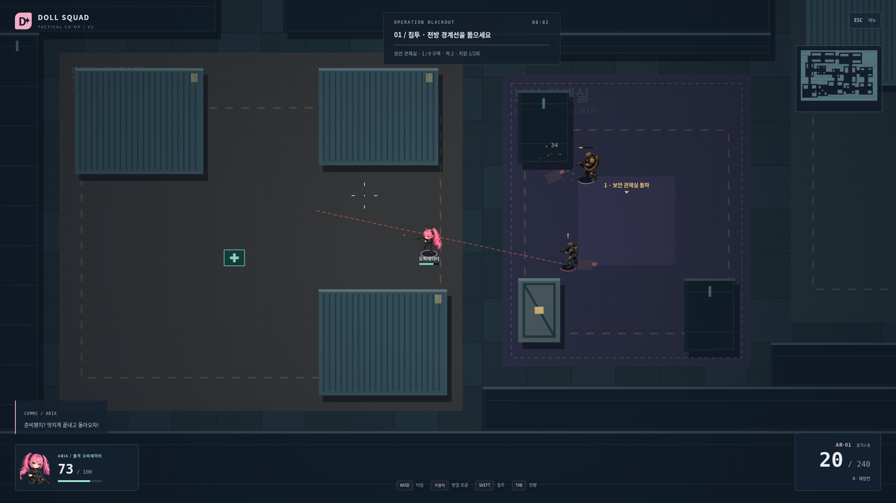
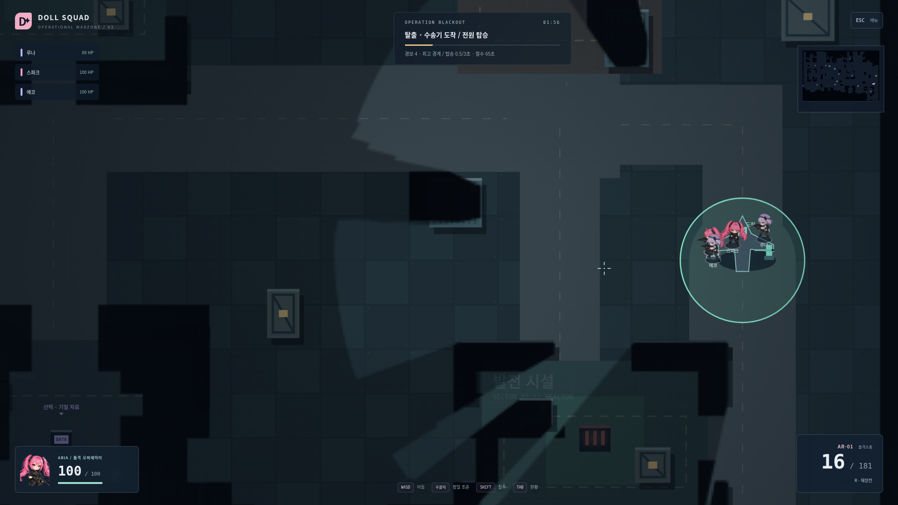
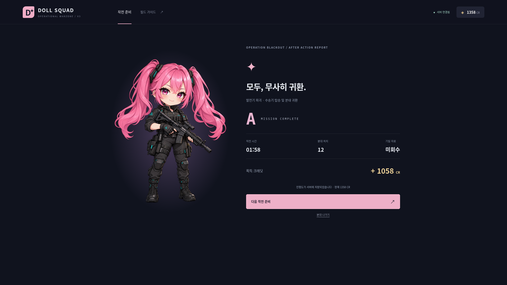

# V2 → V3 실제 화면과 구조 비교

V2 기준 `014ce837f601`. 아래 이미지는 실제 실행 캡처입니다. 합성 렌더 부하 이미지는 게임플레이 증거와 분리합니다.

| 보존                                | 교체                                          |
| ----------------------------------- | --------------------------------------------- |
| AR/SMG/SG·탄약·재장전·서버 피해     | 전멸/체크포인트 → 독립 목표                   |
| 아리아/루나/적 PNG·축소 크기·카메라 | 적 배열 전체 공개 → 서버 시야별 필터링        |
| 방/코드/준비/재접속·로비·해금·저장  | 선형 진행 → 도로 순환/우회와 시설 위치 순열   |
| 30Hz/15Hz·자동 QA                   | 스테이지 증원 → 출동지/대기/실제 문/행군/도착 |
| 발사 미리보기·무기 반동/효과음      | 일반/위험 피해 배율 → 1–10 병력/대응/증원     |

## V2 실제 전투

## V3 공유 시야·사각지대와 자유 작전

벽 뒤 검은 사각지대와 이미 탐색한 어두운 공간을 구분합니다. 다른 대원이 확보한 현재 시야는 공유하지만 보이지 않는 적의 현재 좌표·공격선·미니맵 표식은 공유하지 않습니다. 적 전멸 카운트 대신 발전기2기와 경보가 표시됩니다.

## V3 수송 수단 착륙과 결과

주 목표 완료 뒤에도 적이 활동합니다. 수송기가 도착하기 전에 귀환 처리하지 않으며, 연결된 대원 전원의 집결을 검사합니다.

## 서로 다른 Seed의 실제 작전

- [Seed7 · 1인 선택 목표 포함](final-solo/firing.png)
- [Seed42 · 4인](final-four/firing.png)
- [Seed103 · 2인 역순](final-duo/firing.png)

시설 의미/상대 위치·진입 방향·도로 연결과 우회 관계가 달라집니다. 기준 위치에 오프셋을 준 모듈 생성이므로 완전한 자유형 지형이라고 주장하지 않습니다. 사람 플레이의 경로 선택·전술 차이와 반복 플레이 의향은 자동 조종으로 검증되지 않았습니다.
