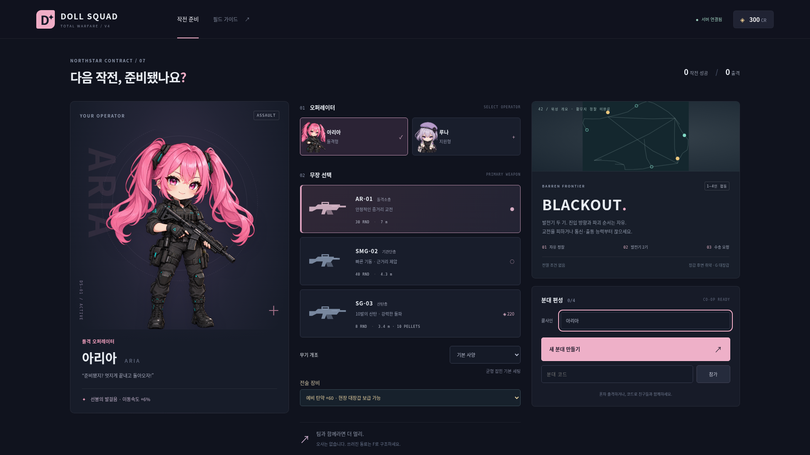
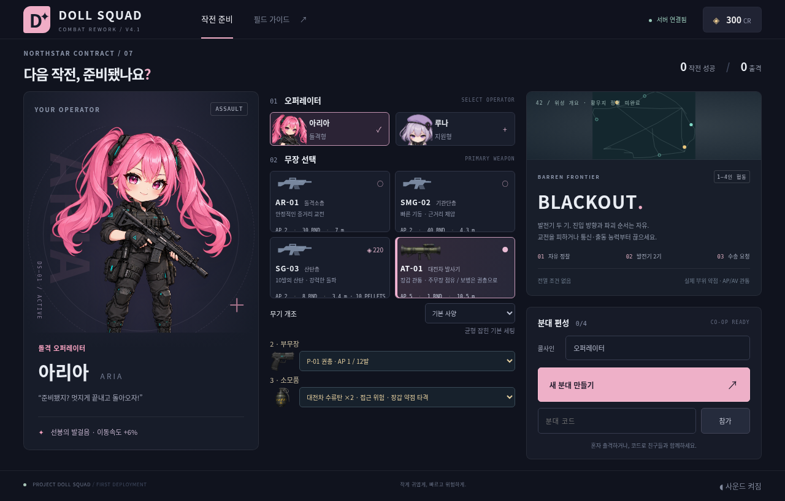
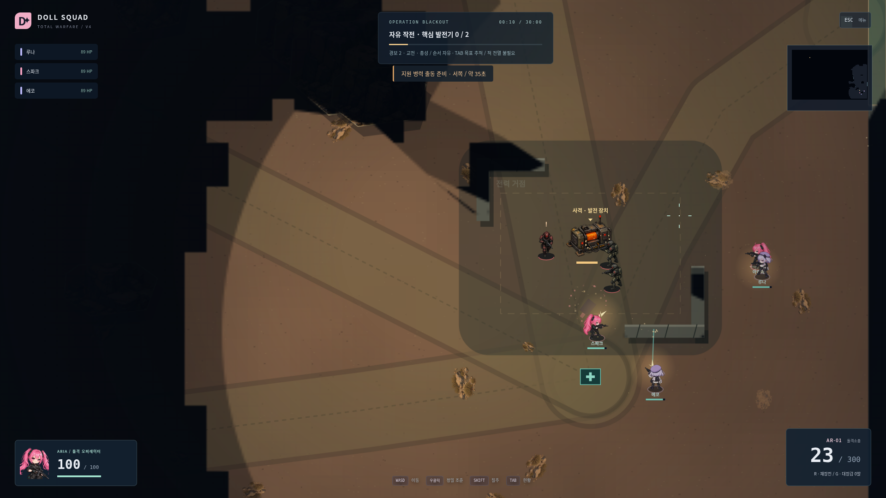
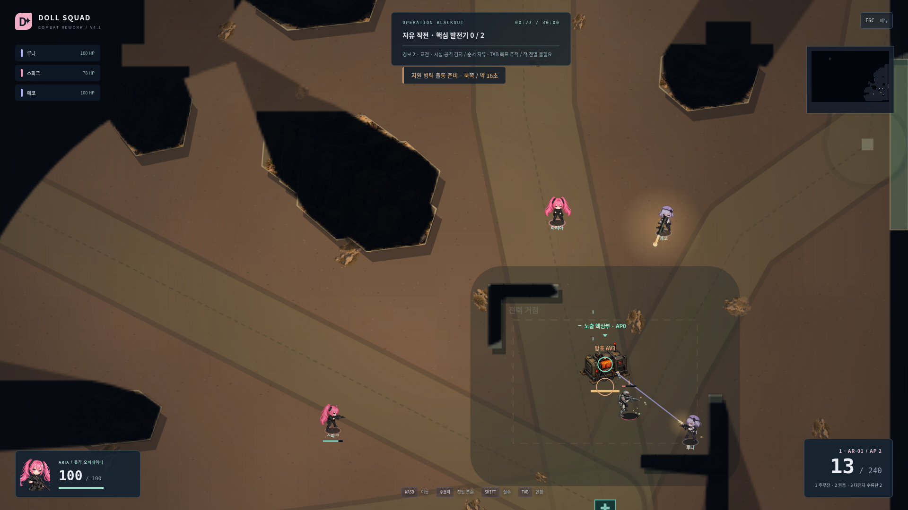

# V4 → V4.1

|영역|V4 기준선|V4.1 실제 구현|
|---|---|---|
|장비 책임|일반 주무장+G 로켓/보급 전술 선택|주무장4종 중 하나+P-01+소모품 하나, AT가 주무장 점유|
|탄약|추가 로켓 인벤토리|주/부무장별 독립 탄창·예비탄·장전·쿨다운·반동|
|장갑|방향별 피해 배율|실제 명중 부위의 AP/AV·일반/내구 피해·부품 HP/본체 기여|
|보행병기 후방|로켓575/650+AR3발|이상적 로켓404.7/650+동력 손상, 파손 핵심부 AR59발 필요|
|이동 대응|D10 3사수 좌우14.0% 명중|관측 속도·제한 추적·요격 역할로42.8%; 벽 엄폐 피해0 유지|
|주 목표|몸체에 일반 사격 가능|정면 방호AV3/실제 후방AV0 핵심부, 기존 경비 즉각 대응|
|소모품|없음|파편·대전차·서버 관측 연막·의료, 유한 공유 보급|
|보존|황무지·PNG·물리 증원·Fog·서버 권한·협동·임무·저장|기존 구조 재사용, 형식1→2 프로필 호환|

## 실제 변경 전후 화면

기준 V4 로비:

V4.1 로비, AT 주무장·권총·대전차 수류탄:

V4 실제 교전:

V4.1 실제4인 교전, 노출 발전기 핵심부/방호 표시:

이미지는 실제 브라우저 원본이며 서로 다른 시점/해상도입니다. 동일 장면의 합성 비교가 아닙니다. 같은 배치의 수치 비교는 `baseline/experiments`와 `final-combat`, 해상도/적 수/Seed를 맞춘 성능 비교는 `performance/v4-*`와 `v41-*`입니다. CPU 비용 증가·60FPS 미달·인간 평가 미검증을 포함한 [상세 QA](QA_RESULTS.md)를 함께 봐야 합니다.
