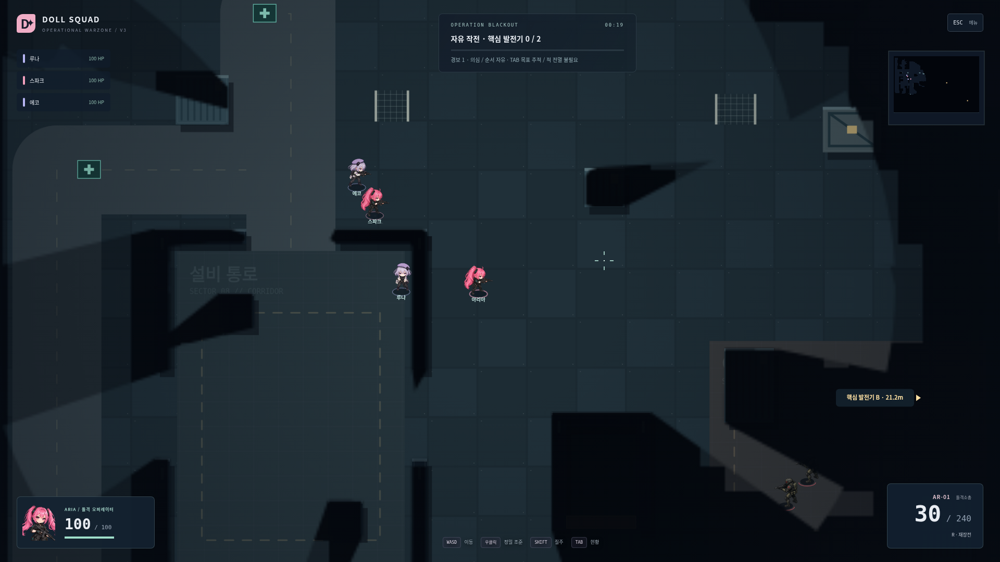
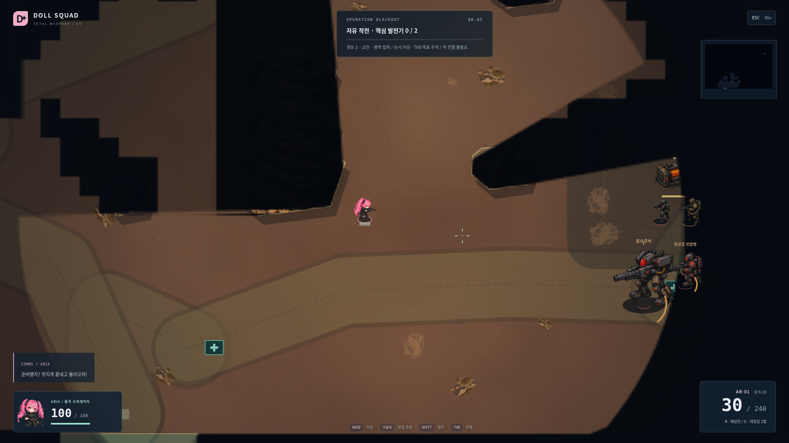
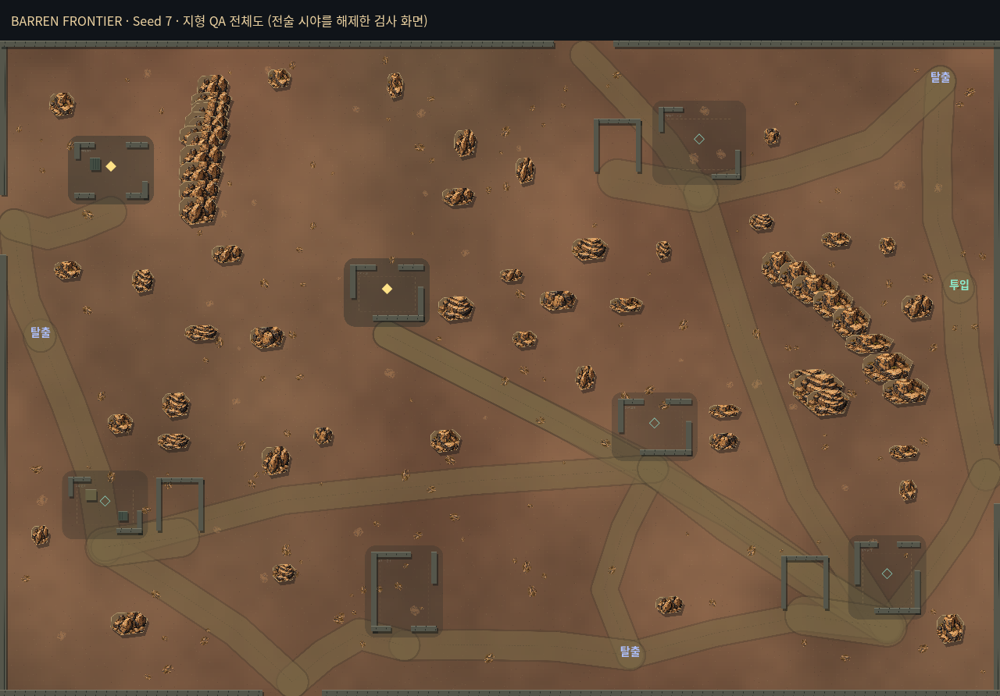
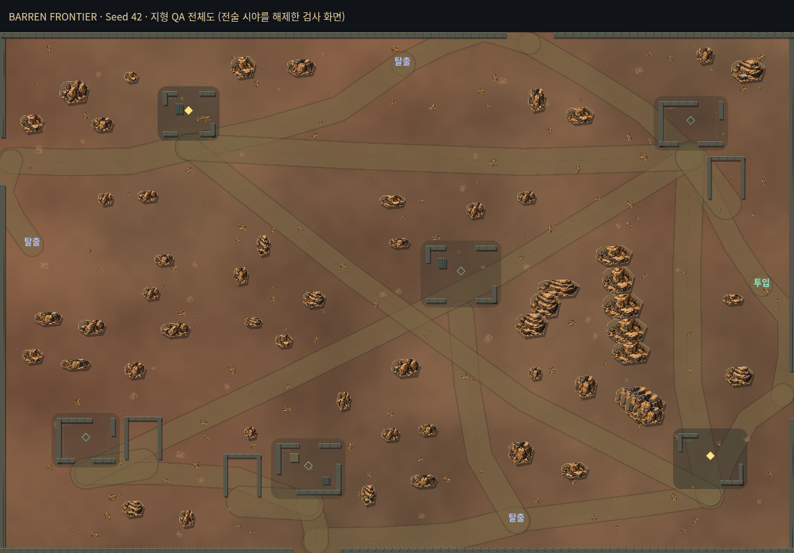

# V3 → V4 실제 화면·구조 비교

| 항목 | V3 | V4 |
|---|---|---|
| 지역 |5000×3300,12개 시설 기준점 |6400×4200 연속 황무지,6–7 자유 위치 거점 |
| 지형 |균일 강철 바닥·직사각형 시설 |암반 능선·협곡 통로·자연 엄폐·흙길 고리·비대칭 폐허 |
| 강적 |소총/돌격/지원, 정예 정확도 |방향 장갑 진압병, 관측 드론, 실제 기관포 보행병기, 관측 기반 공성 포격 |
| 대응 |AR/SMG/SG |기존3총기+제한 로켓, 후방 약점·우회·정비 거점 파괴 |
| 경보 |호출 시 큰 열량, 주로 같은 편성 |소음 상한, 실제 사건별 상승,3 정예/4 장갑·분리 진입·시설 방어 |
| 출동 |30명 단일 생성 상한/비예비 활성 제한 |지역 안전선64+근거리/전략/예비/보병 행군/중장비 별도 슬롯·기존 순찰 재배치 |
| 정보 |공유 시야·필터 |기존 유지+실제 공중 탄 가시성·숨은 발원점 제거·거친 방향 경보 |
| 임무·저장 |자유 발전기2기/선택/수송/원자 저장 |유지+정비 병영 선택 목표와 장갑 출동 연결, 기존 저장 형식 |

V3 원본, 실제4인 작전:

V4 실제 네트워크 작전, 일반 DOM 조작으로 접근한 진압병·보행병기. 이미지를 생성하거나 전투 장면을 합성하지 않았습니다:

## Seed 구조 비교

아래 전체도는 실제 생성기/지형 렌더러를 브라우저에서 실행한 **전지형 검사 화면**입니다. Fog를 적용한 일반 플레이나 실제 클리어를 가장하지 않습니다. 같은 Seed의 네트워크 투입 화면은 각 `seed-*-insertion.png`에 있습니다.

[Seed103](screenshots/phase2/seed-103-overview.png) · [Seed211](screenshots/phase2/seed-211-overview.png) · [Seed997](screenshots/phase2/seed-997-overview.png).

시설 상대 위치·도로 연결·능선·우회 방향·출입구 관계가 달라집니다. 거점 내부4변형과 생성 경로/시야는100 Seed에서 검사했습니다. 완전한3D 지형/높이 탄도나 임의 형상의 모든 건물을 생성하는 시스템은 아닙니다.
